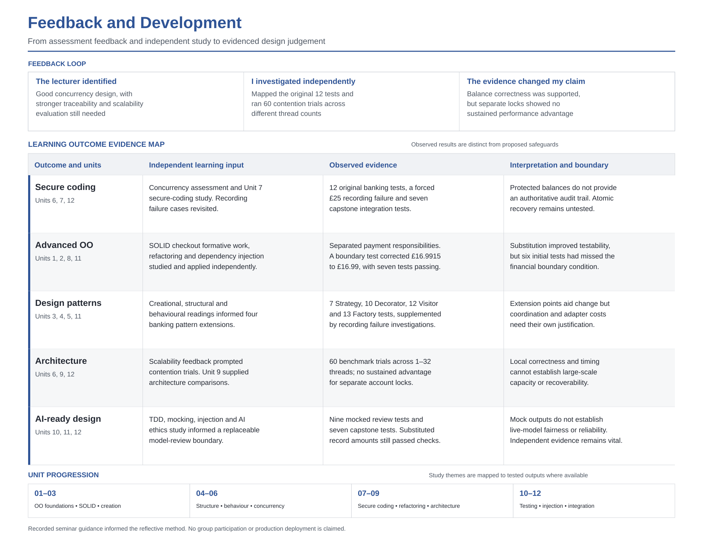

# Feedback and Development

*Figure 1 distinguishes outcomes supported by code and tests from understanding developed through study and safeguards proposed for later implementation. Unit references show where ideas were introduced, not completion of every weekly activity.*

## How I interpreted the assessment feedback

The banking assessment established balance protection under tested concurrent workloads. The lecturer recognised that design while asking for clearer traceability and scalability analysis. I treated these as different questions. The [requirements mapping](../02-Coding-Exercises/BankAccount/REQUIREMENTS_AND_TEST_EVIDENCE.md) made the original twelve tests traceable while exposing worker-thread exceptions and mutable account identifiers. The subsequent [contention investigation](../02-Coding-Exercises/BankAccount/CONTENTION_EVALUATION.md) compared shared and separate accounts across sixty trials. Balances remained correct, but separate locks showed no sustained performance advantage. Kalibera and Jones (2013) helped me interpret variation rather than select favourable timings. The feedback therefore strengthened one conclusion while making another more cautious.

## Learning outcomes across the twelve units

Units 1, 2 and 8 connected object-oriented foundations, SOLID and refactoring to the [checkout formative exercise](../02-Coding-Exercises/SOLID-Checkout/README.md). Separating payment responsibilities allowed a dependency to be mocked, but six passing tests missed a fractional-penny result of £16.9915. A new boundary test and rounding correction brought the suite to seven passing tests. Unit 10's TDD material clarified the value of this failure-driven change without implying the whole exercise was test-first. More modular code had improved testability, not automatically ensured coverage.

Units 3–5 informed the [Strategy](../02-Coding-Exercises/BankAccount/STRATEGY_EVALUATION.md), [Decorator](../02-Coding-Exercises/BankAccount/DECORATOR_EVALUATION.md), [Visitor](../02-Coding-Exercises/BankAccount/VISITOR_EVALUATION.md) and [Abstract Factory](../02-Coding-Exercises/BankAccount/ABSTRACT_FACTORY_EVALUATION.md) extensions. Prechelt et al. (2001) made me less willing to equate pattern use with maintenance gains. A forced recording failure after a £25 deposit showed why. Financial state changed although its record was absent. Separating responsibilities made the weakness easier to expose, but had not supplied a recovery mechanism.

Units 6 and 7 linked concurrency with secure coding, while Unit 9 prompted architectural comparisons. The contention and recording results demonstrate neither production scalability nor durable recovery. I used the architecture case-study material to challenge design assumptions without claiming to have deployed alternative architectures. Units 10–12 added mocking, dependency injection and integration testing. The [model-review tests](../03-Testing/MOCKING_AND_AI_TESTING.md) exercised controlled decisions, while [capstone tests](../05-Capstone-Project/CAPSTONE_EVALUATION.md) exposed substituted records passing checks. Barr et al. (2015) informed my interpretation of this test-oracle weakness. Tabassi (2023) helped connect incomplete evidence with wider AI governance responsibilities. No live-model accuracy or fairness was evaluated.

## Independent learning and next investigation

I revisited lecturecasts, readings, formative material and recorded seminars independently, returning to the first assessment with questions raised by later units. The recorded assessment seminar's emphasis on explaining *what produced learning* shaped this record of decisions. Watching a seminar did not reproduce peer discussion, but the subsequent code, test outcomes and documented limitations make my individual enquiry visible. Kolb's (1984) cycle describes the recurring process of experiment, evaluation and revised action. My next priority is coordinated, durable balance-and-record updates tested under injected failures, followed by independent technical review. These are planned safeguards, not achieved results.

## References

Barr, E.T., Harman, M., McMinn, P., Shahbaz, M. and Yoo, S. (2015) ‘The oracle problem in software testing: A survey’, *IEEE Transactions on Software Engineering*, 41(5), pp. 507–525. Available at https://doi.org/10.1109/TSE.2014.2372785 (Accessed 16 October 2026).

Kalibera, T. and Jones, R.E. (2013) ‘Rigorous benchmarking in reasonable time’, *Proceedings of the ACM SIGPLAN International Symposium on Memory Management*, pp. 63–74. Available at https://doi.org/10.1145/2464157.2464160 (Accessed 16 October 2026).

Kolb, D.A. (1984) *Experiential Learning: Experience as the Source of Learning and Development*. Englewood Cliffs, NJ. Prentice-Hall.

Prechelt, L., Unger, B., Tichy, W.F., Brössler, P. and Votta, L.G. (2001) ‘A controlled experiment in maintenance: Comparing design patterns to simpler solutions’, *IEEE Transactions on Software Engineering*, 27(12), pp. 1134–1144. Available at https://doi.org/10.1109/32.988711 (Accessed 16 October 2026).

Tabassi, E. (2023) *Artificial Intelligence Risk Management Framework (AI RMF 1.0)*. NIST AI 100-1. National Institute of Standards and Technology. Available at https://doi.org/10.6028/NIST.AI.100-1 (Accessed 16 October 2026).
