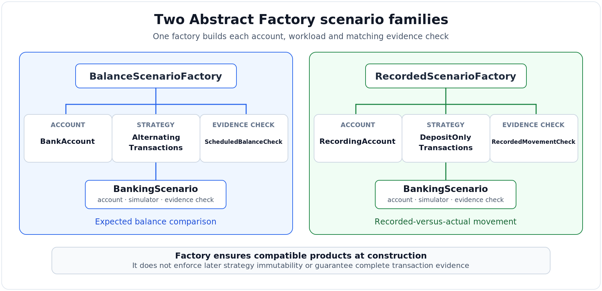

# Abstract Factory and the Limits of Configuration Assurance

Figure 3 shows how `ScenarioFactory` combines an account, transaction strategy and evidence check within each scenario. The two families serve different purposes. `BalanceScenarioFactory` pairs alternating transactions with an expected-balance check, while `RecordedScenarioFactory` checks deposits against recorded movement. This follows Gamma et al. (1994) and reduces opportunities to assemble unsuitable components, but says little about their reliability after construction.

All thirteen factory tests passed. The balance scenario finished at £100, while the recorded scenario returned £140 with eight deposit records. More revealing were the checks for an unrecorded £25 deposit and activity through a second wrapper. Both discrepancies were detected by invoking the evidence check directly, without completing a scenario run. Correct assembly therefore did not guarantee complete transaction evidence.

The configuration can also change after construction. Replacing `StrategySimulator`'s strategy could invalidate the expected balance calculated for its original workload, although this remains untested. `RecordedMovementCheck` compares net movements, so offsetting omissions could still go unnoticed. Furthermore, `BankingScenario.run()` returns an unsuccessful comparison without enforcing a response, whereas a worker exception prevents verification from being reached. These differences expose a gap between detecting an unreliable result and deciding what happens next.

Gamma et al. (1994) acknowledge that adding product types complicates Abstract Factory, while Naghdipour, Hasheminejad and Barmaki (2023) examine the difficulty of selecting suitable patterns. With only two scenarios, simpler construction functions might achieve the same initial consistency with less abstraction. The factory becomes easier to justify as configurations diversify, but handling verification failures and protecting configuration assumptions deserve priority over adding more classes.

## Evidence

- [Factory implementation](scenario_factories.py)
- [Thirteen factory tests](test_scenario_factories.py)

## References

Gamma, E., Helm, R., Johnson, R. and Vlissides, J. (1994) *Design Patterns: Elements of Reusable Object-Oriented Software*. 1st edn. Addison-Wesley Professional. Available at https://www.pearson.com/en-gb/subject-catalog/p/design-patterns-elements-of-reusable-object-oriented-software/P200000009480/9780201633610 (Accessed 14 October 2026).

Naghdipour, A., Hasheminejad, S.M.H. and Barmaki, R.L. (2023) ‘Software design pattern selection approaches: A systematic literature review’, *Software: Practice and Experience*, 53(4), pp. 1091–1122. Available at https://doi.org/10.1002/spe.3176 (Accessed 14 October 2026).
