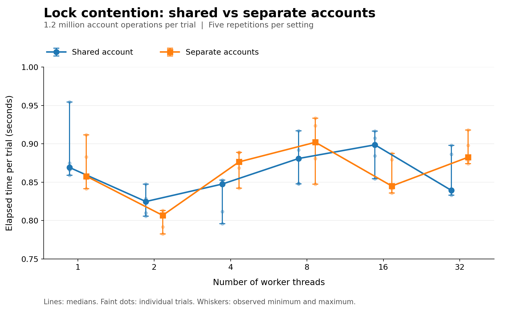

# Examining Lock Contention and Performance

Figure 2 examines my assumption that separate account locks would reduce contention when threads worked on unrelated accounts. I compared shared and separate accounts across sixty trials of 1.2 million operations, using one to thirty-two threads and five repetitions per setting. The results challenged that expectation. Separate accounts were quicker at sixteen threads, yet the shared account performed better at thirty-two. With trial ranges overlapping and the advantage changing direction, I could not distinguish a consistent locking benefit from measurement variation.

Every trial preserved the expected balances, supporting correctness for these deposit-and-withdrawal workloads. However, the benchmark held the total work constant while adding threads, showing how a fixed workload was shared rather than how the design would respond to growing demand. Kalibera and Jones (2013) highlight the importance of variation in benchmarking. Five repetitions and sub-second timings offered limited grounds for distinguishing small performance differences from noise. Python 3.15.0a6 was also an alpha release running with the GIL, which may have constrained parallel execution, although I could not isolate its influence.

My findings support retaining per-account locks for balance protection, not their assumed speed advantage. I would repeat the experiment using stable Python, increasing workloads and free-threaded execution before drawing wider conclusions about scalability.

## Evidence

- [Benchmark implementation](benchmark_contention.py)
- [Extended dataset with 60 trials](contention_results_extended.csv)
- [Earlier dataset](contention_results.csv)

## References

Kalibera, T. and Jones, R.E. (2013) ‘Rigorous benchmarking in reasonable time’, *Proceedings of the ACM SIGPLAN International Symposium on Memory Management*, pp. 63–74. Available at https://doi.org/10.1145/2464157.2464160 (Accessed 14 October 2026).
