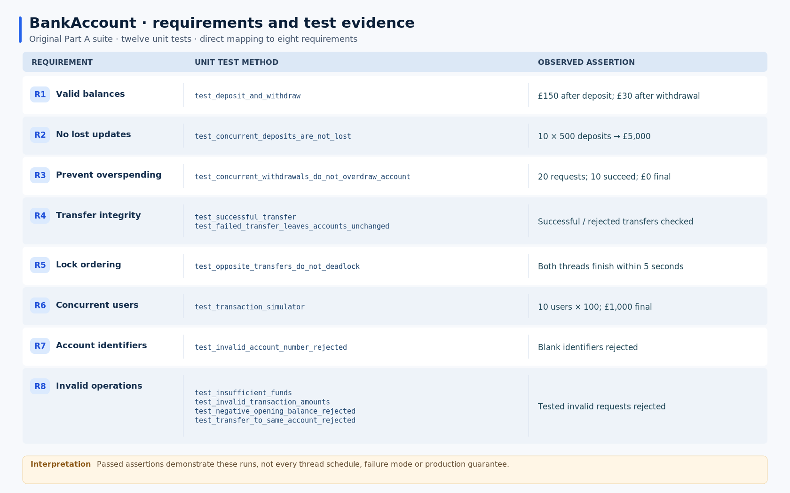

# BankAccount: Requirements and Test Evidence

The figure maps each original requirement to its tests and expected outcomes. The contested-withdrawal test provides stronger evidence for the withdrawal invariant than deposits alone because twenty threads compete for funds sufficient for only ten. However, `threading.Barrier` aligns their starting point, not subsequent execution schedules. Opposing transfers finishing within five seconds likewise support the lock-ordering decision in that run, rather than establishing general deadlock freedom.

The implementation also leaves account identifiers mutable and uniqueness unenforced, potentially weakening the ordering assumption. Currency precision remains unrestricted. More significantly, the original simulator does not propagate worker-thread exceptions to the test thread, so an expected final balance could conceal interrupted operations. The later Strategy simulator captures these errors but cannot reverse completed transactions. I would next test varied schedules, inject worker failures and examine recovery before making stronger assurance claims.

## Evidence

- [Original account implementation](bank_account.py) and [simulator](transaction_simulator.py)
- [Twelve original unit tests](test_bank_account.py)
- [Strategy extension and error handling](STRATEGY_EVALUATION.md)
