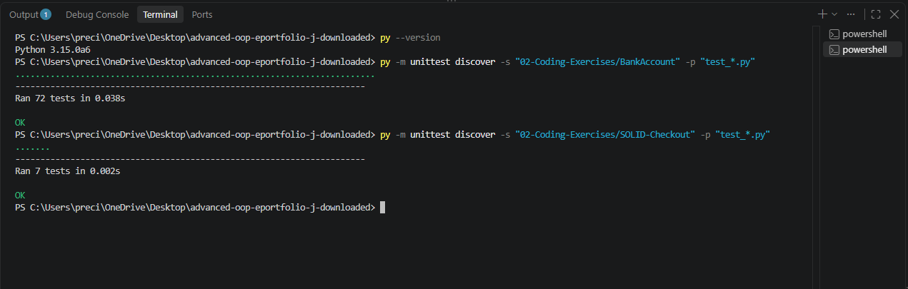

# Testing and AI-Aware Review

This section examines how incomplete transaction records affect the reliability of automated verification and model advice. The investigation uses mocked dependencies to test failure handling and distinguish correct software behaviour from trustworthy financial evidence.

## Evidence

- [Critical evaluation of mocking and test assurance](MOCKING_AND_AI_TESTING.md)
- [Model review implementation](../02-Coding-Exercises/BankAccount/model_review.py)
- [Nine model-review tests](../02-Coding-Exercises/BankAccount/test_model_review.py)
- 
## Verified Test Execution

Both suites were executed locally using Python 3.15.0a6. All 72 banking tests and seven SOLID checkout tests passed, completing in 0.038 and 0.002 seconds respectively. These runs support the reported behaviour in this environment, but do not establish production performance or complete coverage of failure conditions.

