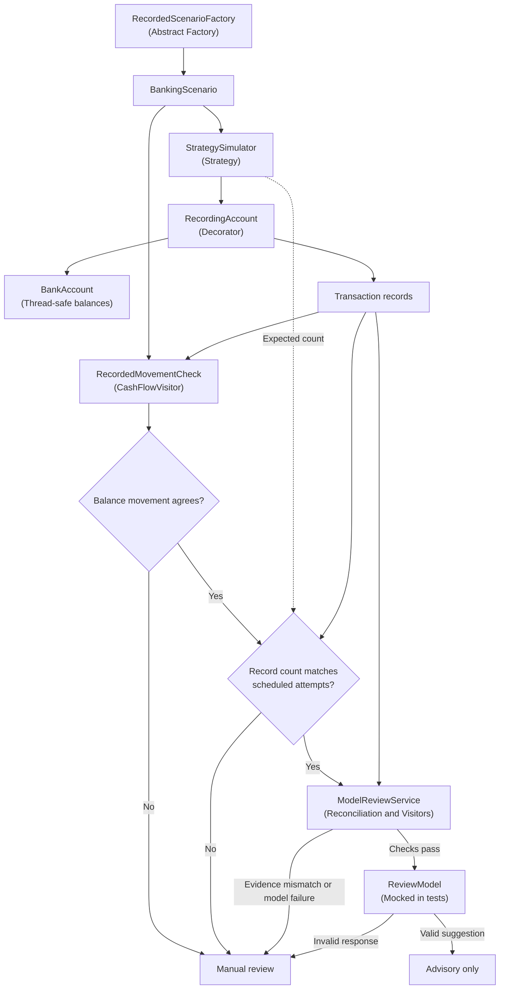

# Capstone Project: Transaction Verification and AI-Aware Review

This capstone brings together the banking exercises to investigate whether recorded transaction evidence is sufficient for model review. The integration adds a record-count check to the existing reconciliation process and tests both its usefulness and its limitations.

## Project evidence

- [Capstone evaluation](CAPSTONE_EVALUATION.md)
- [Workflow implementation](../02-Coding-Exercises/BankAccount/capstone_workflow.py)
- [Integration tests](../02-Coding-Exercises/BankAccount/test_capstone_workflow.py)

## Architecture and verification flow

The diagram shows how the existing banking components support the capstone's verification process. Model advice is only requested after the available transaction evidence passes the preliminary checks.

