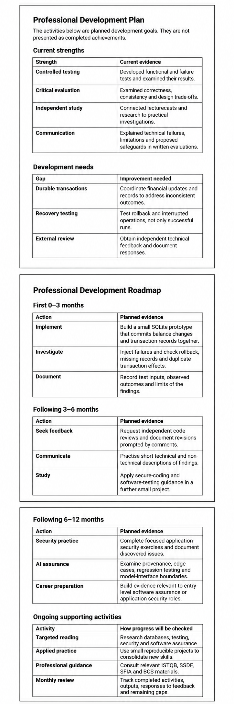

# Task 4 Professional Development Plan

Building the banking system demonstrated my ability to protect shared state, but later recording failures exposed weaknesses that correct balances could not reveal. I want to develop towards application security and software assurance, where reliability needs independently verifiable and recoverable evidence.

Figure 1 turns these findings into practical goals. Boundary tests and repeatable contention trials preceded a tested standalone SQLite prototype for atomic balance-and-record updates. Input-tracing exercises and external code reviews would then improve my evaluation of AI-related evidence and communication of design decisions. Other safeguards remain proposals, not implemented controls.

SFIA 9's PROG, TEST and SCTY skills provide benchmarks for software development, functional testing and information security, without implying independently assessed competence (SFIA Foundation, 2024). ISTQB (2024) informs my testing goals, NIST (2022) guides secure development, and the BCS Code of Conduct (BCS, n.d.) supports professional accountability.

I will review progress monthly against the roadmap's success measures. Reproducible results, recorded failures and responses to feedback matter more than meeting deadlines alone.

## References

BCS (n.d.) *BCS Code of Conduct*. Available at https://www.bcs.org/membership-and-registrations/become-a-member/bcs-code-of-conduct/ (Accessed 14 October 2026).

ISTQB (2024) *Certified Tester Foundation Level Syllabus*, Version 4.0.1. Available at https://www.istqb.org/certifications/certified-tester-foundation-level-ctfl-v4-0/ (Accessed 15 October 2026).

NIST (2022) *Secure Software Development Framework (SSDF) Version 1.1*. NIST SP 800-218. Available at https://doi.org/10.6028/NIST.SP.800-218 (Accessed 15 October 2026).

SFIA Foundation (2024) *SFIA 9 skills directory*. Available at https://sfia-online.org/en/sfia-9/skills (Accessed 14 October 2026).
